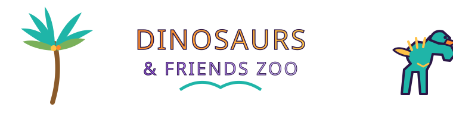

# Dinosaurs & Friends Zoo



A browser game by Daniel McKeown ([altaredwood.work](https://altaredwood.work)), built to the Alta Redwood game-design standards in `spec/`. You are a visitor to a zoo whose residents are dinosaurs (and the very small dinosaurs known as parakeets). The brief is in [`prompt.md`](prompt.md).

## Run it

```
php -S 127.0.0.1:8099 -t .
```

then open <http://127.0.0.1:8099/index.html>. Any static file server also works: **PHP is optional**. Without it, saves go to `localStorage`, accounts are hidden, and dialogue uses the rule-based engine (Settings > Debug shows which mode is active).

Optional backend settings (storage driver, Ollama / cloud LLM) live in `config.php`; override them in an untracked `config.local.php` (see `config.local.example.php`).

## Play

- Buy admission at the gate (box office, 9 am to 9 pm), then explore. A day is about 5 minutes open; the night fast-forwards. Sleep at Hotel Cretaceous (outside the gate) to skip to morning.
- The hotel ATM lets you withdraw $100 at a time, up to $300 per in-game day, for extended visits.
- Walk up to the glass viewing windows and press `.` for a close-up. Buy Brazil nuts and feed the small dinosaurs in the petting pen. Ride the cable car. Fund research at the Genome Lab to rediscover or synthesize new species.
- Talk to visitors, fans and tan-uniformed staff with `/`; join a group with `'`. Press `C` for the camera: shots are watermarked and downloadable.
- Open ZooTV with the TV button in the upper-right HUD or the ZooTV phone tab to watch a selected animal wander, forage, rest, or fly around its habitat.
- In Settings > Account, a signed-in account shows its status and a log-out option instead of the login form. Settings > Save/Load lets you choose explicitly between a browser save and (when signed in) a server save.
- Dinosaurs occasionally escape. Keep clear.
- Settings includes Terms and Privacy tabs covering local play, hosted deployments, optional accounts, and possible host or AI-service data handling.

| Key | Action |
| --- | --- |
| WASD / arrows, Shift | move, run |
| Q / E or drag | rotate camera |
| `/` | talk |
| Tap `.` / X / Enter | interact |
| Hold `.` away from interactions | run |
| `,` | eat / drink |
| `'` | select (join group, shutter) |
| C, P, Esc | camera, phone (settings), pause |

## Layout

- `data/*.json`: world layout, species, dialogue (modular and editable)
- `js/world.js` world and cable car, `js/dino.js` + `js/birds.js` procedural animals (Babylon.js), `js/entities.js` animals/visitors/groups/escapes, `js/ui.js`, `js/game.js`
- `api/index.php`: status, accounts, saves, AI chat proxy (Ollama, cloud, or fallback)
- `vendor/babylon.js`: vendored Babylon.js
- `art/`: photographs and studies used for the parakeet window and species design
- `viewer.html`: species gallery for development (`?sp=trex&state=eat`) and ZooTV habitat views (`?tv=1&sp=trex`)
